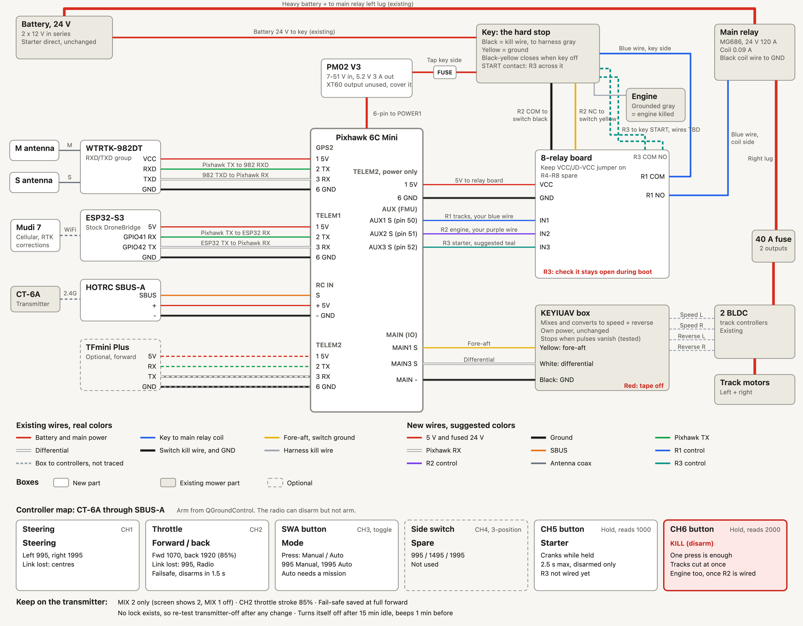

# jakkuh auto-mower

An RC tracked gas mower (SDLOOL LM1200) converted to an autonomous RTK-guided mower, using a Pixhawk running ArduPilot Rover.

**Video:** [watch it on YouTube](https://youtu.be/vGg9lFf3mJU)

This repo has the ArduPilot parameter file, the Lua script that runs on the Pixhawk, the wiring diagram, and setup notes. The browser-based mission planner I use with it is in a separate repo: [jakkuh/mowplanner](https://github.com/jakkuh/mowplanner).



> **Safety.** This drives a heavy machine with a spinning blade. It is a hobby project, not a product. Keep an RC kill switch in your hand and stay within reach of the key whenever it runs. Bench-test everything with the tracks off the ground and the engine off first. You use any of this at your own risk.

## How it works

```text
RTK base (NTRIP) ──> ground station ──WiFi──> ESP32 (DroneBridge) ──TELEM1──> Pixhawk 6C Mini
                                                                                │
   UM982 dual-antenna RTK GPS ──GPS2──────────────────────────────────────────>│  position + heading
   HOTRC SBUS receiver ──RC IN────────────────────────────────────────────────>│  manual drive + kill
                                                                                │
   MAIN1/MAIN3 PWM ──> KEYIUAV mixer box ──> stock track controllers ──> tracks │
   AUX1-3 ──> relay board: R1 track power, R2 engine kill, R3 starter           │
```

ArduPilot runs the tracks as a skid-steer rover. The Lua script (`ardupilot/scripts/mower_safety.lua`) turns ArduPilot's left and right track outputs into the fore-aft and differential signals the mower's stock mixer box expects. It also adds what the stock controllers need: it lifts commands past their dead zone, holds neutral briefly on direction changes, and gives pivots extra torque. It also handles relays and safety stops: tilt, rangefinder (optional), and engine kill on disarm.

## Hardware

What I used. Most of it can be swapped for similar parts, but the params and script assume this layout.

| Part | Job |
|---|---|
| SDLOOL LM1200 RC tracked mower (24 V, gas engine for the blade) | The base machine |
| [Holybro Pixhawk 6C Mini](https://holybro.com/products/pixhawk-6c-mini) | Flight controller, ArduPilot Rover 4.6+ (tested on 4.7.2) |
| Holybro PM02 V3 power module | 24 V to 5 V for the Pixhawk |
| WitMotion WTRTK-982DT (Unicore UM982) + 2 antennas | RTK position and dual-antenna heading (no compass) |
| ESP32-S3 board running [DroneBridge for ESP32](https://github.com/DroneBridge/ESP32) | MAVLink over WiFi |
| [GL.iNet Mudi 7 (GL-E5800)](https://jakkuh.com/mudi7) or any WiFi router | WiFi in the yard; optional cellular / Tailscale remote access |
| HOTRC CT-6A transmitter + SBUS-A receiver | Manual driving, mode switch, kill button |
| KEYIUAV dual-channel PWM-to-0-5 V box | Already in the mower; takes fore-aft and differential PWM |
| 8-channel 5 V relay board (active-low) | R1 track power (main relay coil), R2 engine kill, R3 starter |
| RTK corrections (NTRIP) | Your own base station, or a public or paid NTRIP service. See [RTK corrections](#rtk-corrections) |
| Benewake TFmini Plus (optional) | Forward obstacle stop |

## Software you need

- [ArduPilot Rover](https://ardupilot.org/rover/) firmware 4.6 or later on the Pixhawk ([firmware downloads](https://firmware.ardupilot.org/Rover/))
- A ground station: [Mission Planner](https://ardupilot.org/planner/) or [QGroundControl](https://qgroundcontrol.com/), for loading params, the script, and RTK corrections
- [DroneBridge for ESP32](https://github.com/DroneBridge/ESP32) firmware, using the [online flasher](https://drone-bridge.com/flasher/)
- Optional: [mowplanner](https://github.com/jakkuh/mowplanner), a browser app that draws lawn boundaries, generates mowing paths, uploads missions and forwards NTRIP corrections. It runs on a laptop or a home server (Docker), so RTK keeps flowing when your laptop sleeps

## Setup

1. **Wire it.** Follow the [wiring diagram](docs/wiring-diagram.html) and [wiring and code map](docs/wiring-and-code-map.md). The diagram is interactive (zoom and pan, controller map, PNG export). Open it locally in a browser. Never put 24 V on the Pixhawk or its rails; it is 6 V max.
2. **Set up the WiFi link.** Flash DroneBridge onto the ESP32, wire it to TELEM1, and join it to your WiFi: [ESP32 and Mudi setup](docs/esp32-and-mudi-setup.md).
3. **Load the parameters.** In Mission Planner: **Config > Full Parameter List > Load from file**, then choose [`ardupilot/mower.param`](ardupilot/mower.param) and **Write Params**. Reboot, then load and write it again, because some params only appear once their enable param is set.
4. **Install the script.** Copy [`ardupilot/scripts/mower_safety.lua`](ardupilot/scripts/mower_safety.lua) to `APM/scripts/` on the Pixhawk's SD card, using MAVFTP (Mission Planner: **Config > MAVFTP**) or a card reader. Reboot and look for `Mower: safety script started`, with no `FAULT` message.
5. **Bench-test.** Work through the [bench-test order](ardupilot/README.md#bench-test-order) with the tracks off the ground and the engine off. Measure and set the `TUNE` / `# TODO` values for your machine.
6. **Set up RTK.** Point your ground station's NTRIP / RTK inject (or mowplanner's NTRIP setting) at your caster. Wait for RTK Fixed before running a mission.
7. **Mow.** Plan a mission (Mission Planner survey grid, or mowplanner), upload it, and switch to Auto from the transmitter.

## RTK corrections

The mower needs RTCM3 corrections over NTRIP to get centimetre accuracy. Without them it falls back to about 1.5 m, which is not good enough to mow. Any of these works:

- **Your own base station.** A second RTK receiver (UM980/UM982, ZED-F9P, etc.) at a fixed spot at home, serving NTRIP on your network. Best accuracy, since it's metres from the lawn. [ArduSimple's RTK explainer](https://www.ardusimple.com/rtk-explained/) is a good starting point.
- **A free community caster**, such as [RTK2go](http://rtk2go.com/) or [Centipede](https://docs.centipede.fr/) (mostly Europe), if someone runs a base within about 20-30 km of you.
- **A paid or government network**, such as [Point One Polaris](https://www.pointonenav.com/polaris) or your state or provincial RTK network.

Fix your base's coordinates before saving any lawn boundaries or missions. A base that re-surveys its own position at each start can shift everything by a metre or two.

## Repo layout

| Path | What it is |
|---|---|
| [`ardupilot/mower.param`](ardupilot/mower.param) | Full parameter set, with comments on why each value is what it is |
| [`ardupilot/scripts/mower_safety.lua`](ardupilot/scripts/mower_safety.lua) | The Pixhawk Lua script: drive conversion, dead-zone lift, relays, safety stops |
| [`ardupilot/test/`](ardupilot/test) | Mock tests for the script (`lua ardupilot/test/test_mower_safety.lua`) and a SITL check |
| [`ardupilot/README.md`](ardupilot/README.md) | Script details, known failure modes, bench-test order, tuning TODOs |
| [`docs/wiring-diagram.html`](docs/wiring-diagram.html) | Interactive wiring diagram (open in a browser) |
| [`docs/wiring-and-code-map.md`](docs/wiring-and-code-map.md) | Pin-by-pin wire map, relay logic, RTK notes |
| [`docs/esp32-and-mudi-setup.md`](docs/esp32-and-mudi-setup.md) | DroneBridge and WiFi / remote access setup |
| [`tools/`](tools) | Helper scripts: relay bench test, UM982 monitor, spiral path generator |

## Useful links

- [ArduPilot Rover docs](https://ardupilot.org/rover/), including [skid steering](https://ardupilot.org/rover/docs/rover-motor-and-servo-configuration.html) and [tuning](https://ardupilot.org/rover/docs/rover-tuning-process.html)
- [ArduPilot Lua scripting](https://ardupilot.org/rover/docs/common-lua-scripts.html)
- [Moving-baseline (dual-antenna) GPS heading](https://ardupilot.org/rover/docs/common-gps-for-yaw.html)
- [DroneBridge for ESP32 docs](https://dronebridge.gitbook.io/docs/dronebridge-for-esp32/)

## License

[MIT](LICENSE)
